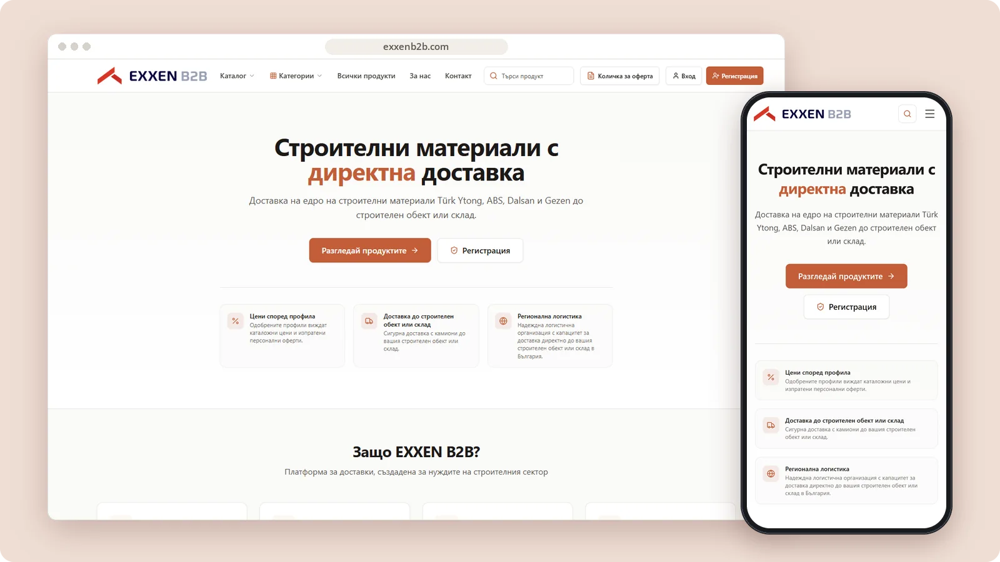

# Exxen B2B

A Bulgarian B2B platform for construction-material discovery, quotations and delivery coordination.

**[Visit exxenb2b.com ↗︎](https://exxenb2b.com)** &nbsp;·&nbsp; [More work by Mert Ömeroğlu](https://github.com/mertomeroglu)

> Exxen B2B is a separate project from Exxen House and Aksesuarlia.

### Highlights

- Product catalogue, category navigation and search
- Quotation list and company registration entry points
- Profile-based pricing and logistics messaging
- Technical documents and certificates

### Built with

Next.js · React

### Screens

---

Presentation-only repository. Images are real, unmodified product screens in a simple frame; application source and private configuration are not published here. Brands and visual content belong to their respective owners — see [LICENSE](LICENSE).
