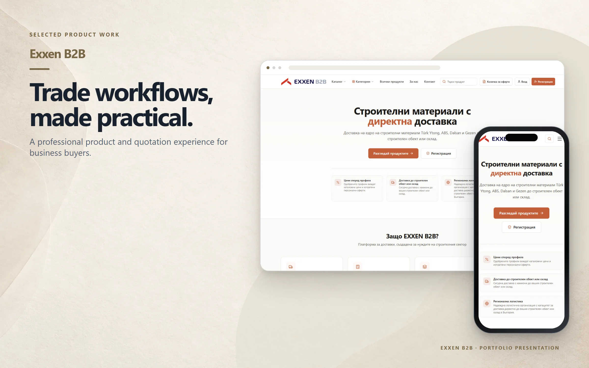
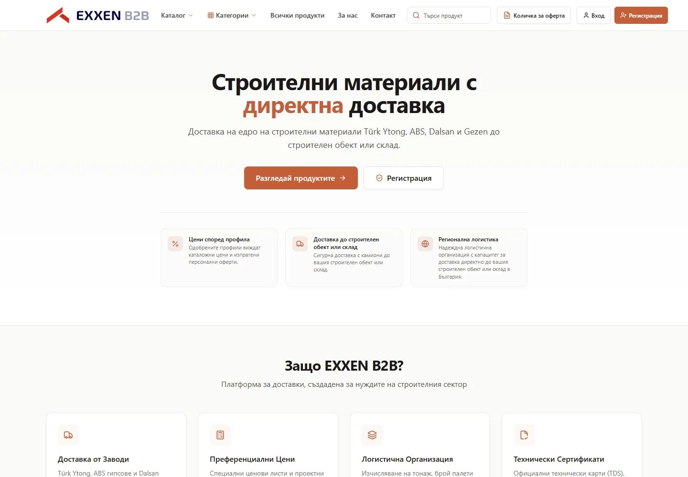
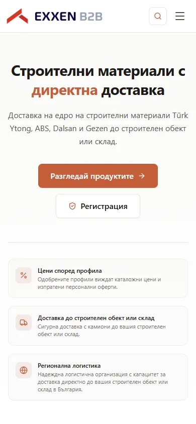

# EXXEN B2B

A Bulgarian B2B platform for construction-material discovery, quotations, and delivery coordination.

**[Visit live website](https://exxenb2b.com)**

## Highlights

- Product catalogue, category navigation, and search
- Quotation list and corporate registration entry points
- Profile-based pricing and logistics messaging
- Technical document and certificate presentation

## Verified technology

Next.js and React are confirmed from the live public application output. This project is independent from Exxen House and Aksesuarlia.

## Live interface

 

## About this repository

This presentation-only repository contains selected public screenshots, this README, and a small static introduction page. Application source and private configuration are not published here.

Visual content and brand assets remain the property of their respective owners. See [LICENSE](LICENSE).
