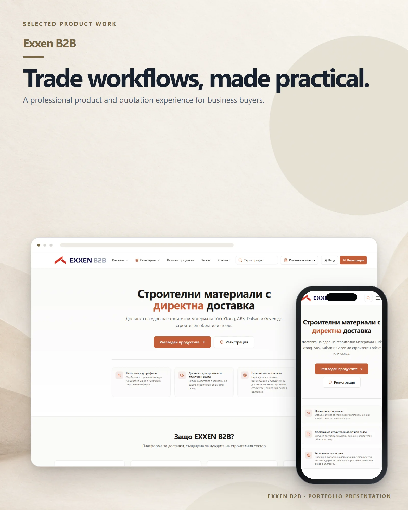

# Exxen B2B

A Bulgarian B2B platform for construction-material discovery, quotations and delivery coordination.

**Live:** [exxenb2b.com](https://exxenb2b.com) &nbsp;·&nbsp; **More work:** [github.com/mertomeroglu](https://github.com/mertomeroglu)

Exxen B2B is a separate project from Exxen House and Aksesuarlia.

### Highlights

- Product catalogue, category navigation and search
- Quotation list and company registration entry points
- Profile-based pricing and logistics messaging
- Technical documents and certificates

### Built with

Next.js · React

---

Presentation-only repository: this README and two presentation images built from real product screens. Application source and private configuration are not published here. Visual content and brand assets remain the property of their respective owners — see [LICENSE](LICENSE).
